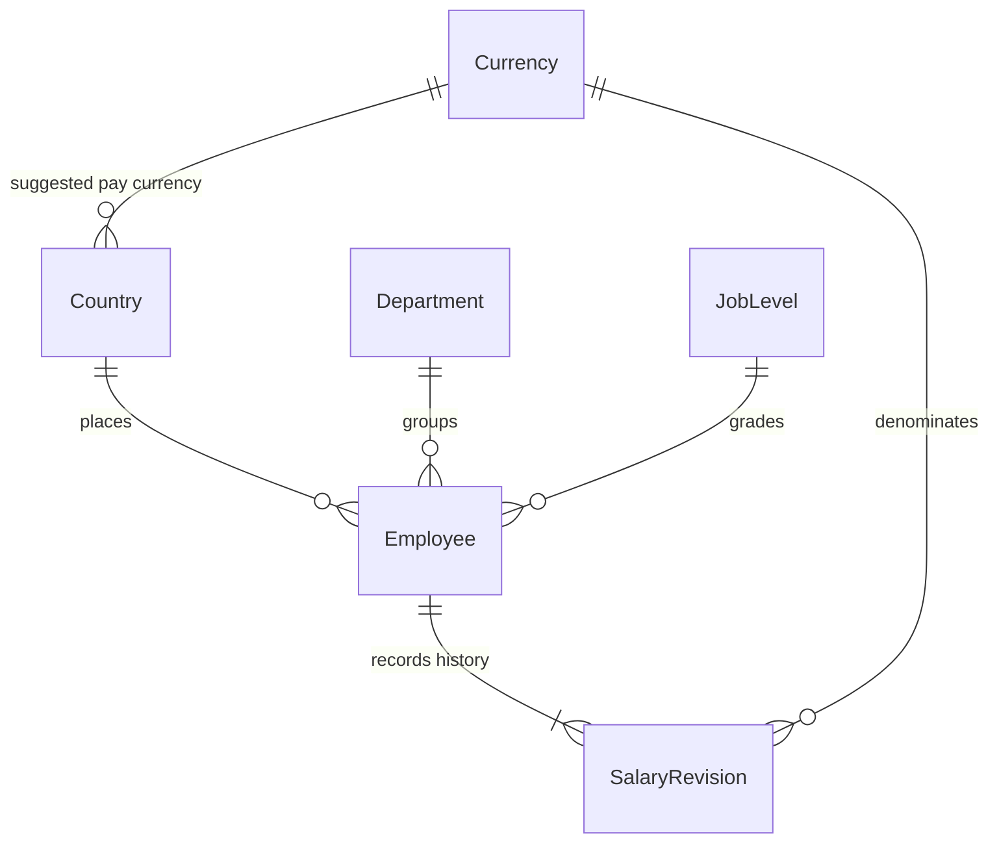

# Backend plan

**Status:** Entity LLD agreed. API routes are the next planning step.  
**Depends on:** [requirements.md](./requirements.md)

This file records decisions. The requirements file records what the HR manager can do. When they disagree, the requirements win and this plan is updated.

## Review of the initial design

The six-entity model stands. Reference rows (country, department, level, currency) keep filters and groups stable. Pay stays on `SalaryRevision`, and current pay is derived so a future raise cannot become current early. `ACTIVE` and `ON_LEAVE` count in payroll; `TERMINATED` stays searchable and drops out of totals.

These gaps were still open, and the entity LLD below closes them:

| Gap | Decision |
| --- | --- |
| Column types and lengths were unnamed | Specified in the Prisma contract. Salary is `DECIMAL(14, 2)`. Rates are `DECIMAL(18, 8)`. |
| Surrogate key type was unnamed | UUID for department, level, employee, and revision. Country and currency use their ISO codes. |
| “Higher id” as a tie-break assumes ordered ids | UUIDs are not insertion-ordered. Tests that care about a tie set `createdAt` explicitly. Equal timestamps fall back to `id DESC`, which is stable. |
| Deleting a country or an employee was unspecified | Every foreign key is `ON DELETE RESTRICT`. This version has no delete API. Leaving the company sets `TERMINATED`. A mistaken raise is a new revision. |
| Revisions looked editable | A revision is insert-only. It has no `updatedAt`. |
| “Today” had no clock | The business date is `(CURRENT_TIMESTAMP AT TIME ZONE 'UTC')::date`. Session time zone cannot change who is current. |
| `Decimal` did not say where rounding happens | Arithmetic stays on `Prisma.Decimal` and PostgreSQL `NUMERIC`. USD display values round half up to 2 places. JSON sends money as strings. |
| A composite employee index was listed by default | At 10,000 rows the revision lookup index is the one that matters. Employee filters can use the primary key and the foreign keys. |
| An employee with zero revisions was only a seed promise | The seed and any future hire path insert the employee and the first revision in one transaction. |
| One shared `rateDate` was not enforceable by a foreign key | The seed writes one date on every currency row, and a test asserts they match. |

## Architecture decisions

| Decision | Choice | Why |
| --- | --- | --- |
| API shape | Express, TypeScript, routes under `/api/v1` | Matches the chosen stack. Versioning leaves room for a later break without renaming the product. |
| Data access | PostgreSQL 16 through Prisma 6 | Relational filters and aggregates fit payroll questions. Prisma keeps the schema in the repo and generates the client. |
| Layout | One folder per module (`routes`, `controller`, `service`, `repository`) under `src/modules` | A salary change touches validation, rules, and queries together. Shared code stays in `config`, `middlewares`, `lib`, and `utils`. |
| Logging | Winston | JSON logs in production, colorized text in development. `LOG_LEVEL` is `error`, `warn`, `info`, `http`, `debug`, or `silent`. |
| Validation | Zod on every body, query, and route param | Invalid salary input fails before a service runs. |
| Errors | `AppError` plus one error middleware | Clients always receive `{ success, data? , error? }`. Production responses omit stacks. |
| Auth | One shared login, checked outside the salary model | The only persona is the HR manager. A user table, roles, and `createdBy` wait until a second persona exists. |
| Money | PostgreSQL `NUMERIC` and `Prisma.Decimal` end to end | Binary `number` drifts on fractional cents and on `amount × rate`. The calculation rule is in “Money arithmetic”. |
| Keys | UUID surrogates; ISO codes for country and currency | Codes are the values the API and the seed already speak. UUIDs keep employee and revision ids opaque. |
| Deletes | `ON DELETE RESTRICT` on every foreign key | History and reference rows stay put. Termination is a status, and a pay correction is a new revision. |
| Business date | UTC calendar date | One clock decides whether a raise has started, in every country. |
| Current pay | Derived from revisions | A stored “current” flag would drift, and a future-dated raise must not become current early. |

## Application structure

```text
src/
├── config/                 # Zod-validated environment
├── lib/                    # Prisma client
├── middlewares/            # security, validation, errors, request log
├── modules/
│   └── <module>/
│       ├── <module>.routes.ts
│       ├── <module>.controller.ts
│       ├── <module>.service.ts
│       └── <module>.repository.ts
├── utils/
├── app.ts
└── server.ts
```

`modules/index.ts` mounts each module router. Health already follows this shape. Employees, salary revisions, and dashboard queries will too.

## Domain model

Six entities. Country, department, level, and currency are reference data for filters and groups. Employee is the directory row. SalaryRevision is the pay history.

Salary bands are fixed USD ranges in application code. The HR login is an environment secret, not a table.

### Country

A filter and a dashboard group. `defaultCurrencyCode` pre-fills a new revision. The revision still stores the currency actually paid.

| Field | Purpose |
| --- | --- |
| `code` | ISO alpha-2 primary key, such as `IN`. |
| `name` | Display label. |
| `defaultCurrencyCode` | Suggested pay currency for this country. |

### Department

A closed list so spelling variants do not split a payroll group. Job title stays free text on the employee because the directory does not filter by title.

| Field | Purpose |
| --- | --- |
| `id` | Surrogate key. |
| `name` | Unique name used in filters and groups. |

### Job level

A filter and a comparison axis. `rank` orders junior before senior without sorting on the label.

| Field | Purpose |
| --- | --- |
| `id` | Surrogate key. |
| `code` | Unique short label, such as `L3`. |
| `name` | Longer label. |
| `rank` | Integer sort order. Lower rank is more junior. |

### Currency

Unknown currencies are rejected because they are absent from this table. Org-wide comparison uses one static snapshot, so the rate is an attribute of the currency. `usdPerUnit` is how many US dollars one unit of this currency converts to. USD is `1`. Every row shares the snapshot’s `rateDate`, which the UI shows next to approximate USD totals.

| Field | Purpose |
| --- | --- |
| `code` | ISO 4217 primary key, such as `INR`. |
| `name` | Display label. |
| `usdPerUnit` | Decimal rate for org-wide USD totals only. |
| `rateDate` | Date this snapshot was fixed. |

Native-currency totals use the revision amount directly.

### Employee

Who the person is and where they sit today. Pay is not stored here. Country, department, and level describe the current assignment. Department history is out of scope.

`status` is `ACTIVE`, `ON_LEAVE`, or `TERMINATED`. People on leave are still paid, so dashboard headcount and payroll include `ACTIVE` and `ON_LEAVE`. Terminated employees stay in the directory and drop out of pay totals.

| Field | Purpose |
| --- | --- |
| `id` | Surrogate key. |
| `firstName`, `lastName` | Name search matches either column. |
| `email` | Unique, stored lowercase. |
| `countryCode` | Filter and payroll by country. |
| `departmentId` | Filter and payroll by department. |
| `levelId` | Filter and pay by level. |
| `jobTitle` | Shown on the salary record. |
| `status` | Directory filter and the dashboard population rule above. |
| `hireDate` | Shown on the salary record. |
| `createdAt` | When the row was inserted. |

The seed inserts each employee and their first revision in one transaction, so a directory row always has a salary.

### Salary revision

A raise adds a row. Older rows stay. `amount` is gross annual salary in that row’s currency, greater than zero. `effectiveDate` is a calendar date and may be in the future. `createdAt` is when HR recorded the change. `reason` is required.

| Field | Purpose |
| --- | --- |
| `id` | Surrogate key. |
| `employeeId` | Owner of this revision. |
| `amount` | Gross annual salary, decimal, greater than zero. |
| `currencyCode` | Currency of this amount. A later revision may change currency. |
| `effectiveDate` | Date the amount takes effect. |
| `reason` | Why the amount changed. |
| `createdAt` | When the revision was recorded. |

Same-day revisions are allowed, so `(employeeId, effectiveDate)` is not unique.

### Current salary

The current revision for an employee is the one with the latest `effectiveDate` on or before today. If two share that date, the later `createdAt` wins, then the higher `id`. Future-dated rows remain history until that date.

The directory salary column, high and low pay, and every aggregate use this revision.

### Relationships



### Indexes

| Index | Serves |
| --- | --- |
| `employees.email` unique | Directory search. |
| `salary_revisions (employee_id, effective_date DESC, created_at DESC, id DESC)` | Current-revision lookup for each employee. |
| Unique `departments.name`, `job_levels.code`, `job_levels.rank` | Stable filter values and a single level order. |

Ten thousand employees do not need a composite index on status, country, department, and level. PostgreSQL can filter that table directly. Add a composite only if a measured query shows a sequential scan becoming the cost.

## Entity LLD

The conceptual fields above stay the meaning of each column. This contract adds type, nullability, and database constraints. Every column is `NOT NULL`.

Prisma model and field names are PascalCase and camelCase. Tables and columns are snake_case through `@map` / `@@map`.

```prisma
enum EmploymentStatus {
  ACTIVE
  ON_LEAVE
  TERMINATED
}

model Country {
  code                String   @id @db.Char(2)
  name                String   @db.VarChar(100)
  defaultCurrencyCode String   @map("default_currency_code") @db.Char(3)
  defaultCurrency     Currency @relation("CountryCurrency", fields: [defaultCurrencyCode], references: [code], onDelete: Restrict)
  employees           Employee[]

  @@map("countries")
}

model Department {
  id        String     @id @default(uuid()) @db.Uuid
  name      String     @unique @db.VarChar(100)
  employees Employee[]

  @@map("departments")
}

model JobLevel {
  id        String     @id @default(uuid()) @db.Uuid
  code      String     @unique @db.VarChar(10)
  name      String     @db.VarChar(100)
  rank      Int        @unique
  employees Employee[]

  @@map("job_levels")
}

model Currency {
  code        String   @id @db.Char(3)
  name        String   @db.VarChar(100)
  usdPerUnit  Decimal  @map("usd_per_unit") @db.Decimal(18, 8)
  rateDate    DateTime @map("rate_date") @db.Date
  countries   Country[]         @relation("CountryCurrency")
  revisions   SalaryRevision[]

  @@map("currencies")
}

model Employee {
  id           String           @id @default(uuid()) @db.Uuid
  firstName    String           @map("first_name") @db.VarChar(100)
  lastName     String           @map("last_name") @db.VarChar(100)
  email        String           @unique @db.VarChar(254)
  countryCode  String           @map("country_code") @db.Char(2)
  departmentId String           @map("department_id") @db.Uuid
  levelId      String           @map("level_id") @db.Uuid
  jobTitle     String           @map("job_title") @db.VarChar(120)
  status       EmploymentStatus @default(ACTIVE)
  hireDate     DateTime         @map("hire_date") @db.Date
  createdAt    DateTime         @default(now()) @map("created_at") @db.Timestamptz(6)
  country      Country          @relation(fields: [countryCode], references: [code], onDelete: Restrict)
  department   Department       @relation(fields: [departmentId], references: [id], onDelete: Restrict)
  level        JobLevel         @relation(fields: [levelId], references: [id], onDelete: Restrict)
  revisions    SalaryRevision[]

  @@map("employees")
}

model SalaryRevision {
  id            String   @id @default(uuid()) @db.Uuid
  employeeId    String   @map("employee_id") @db.Uuid
  amount        Decimal  @db.Decimal(14, 2)
  currencyCode  String   @map("currency_code") @db.Char(3)
  effectiveDate DateTime @map("effective_date") @db.Date
  reason        String   @db.VarChar(500)
  createdAt     DateTime @default(now()) @map("created_at") @db.Timestamptz(6)
  employee      Employee @relation(fields: [employeeId], references: [id], onDelete: Restrict)
  currency      Currency @relation(fields: [currencyCode], references: [code], onDelete: Restrict)

  @@index([employeeId, effectiveDate(sort: Desc), createdAt(sort: Desc), id(sort: Desc)])
  @@map("salary_revisions")
}
```

Prisma cannot declare check constraints. The first migration adds:

- `salary_revisions.amount > 0`
- `currencies.usd_per_unit > 0`
- `job_levels.rank > 0`

### Write rules

Reference rows are seed data. This version has no API to create countries, departments, levels, or currencies.

An employee row is created only together with its first revision, in one transaction. This version’s API does not edit employee identity or assignment. The directory reads those columns; salary changes go to `salary_revisions`.

A revision is immutable. The create path rejects:

- a missing amount, an amount that is not greater than zero, or an amount with more than 2 decimal places
- a `currencyCode` that is not in `currencies`
- an `effectiveDate` that is not a real `YYYY-MM-DD` date
- a blank `reason`, or one longer than 500 characters after trimming

`email`, `code` fields, and currency codes are trimmed and stored uppercase for codes and lowercase for email. Names and titles are trimmed. `firstName` and `lastName` are 1–100 characters. `jobTitle` is 1–120.

### Current salary query

“Today” is the UTC calendar date:

```sql
(CURRENT_TIMESTAMP AT TIME ZONE 'UTC')::date
```

For each employee the current revision is:

```sql
SELECT revision.*
FROM salary_revisions AS revision
WHERE revision.employee_id = $employeeId
  AND revision.effective_date <= (CURRENT_TIMESTAMP AT TIME ZONE 'UTC')::date
ORDER BY revision.effective_date DESC,
         revision.created_at DESC,
         revision.id DESC
LIMIT 1
```

Directory and dashboard queries use the same ordering through a `LATERAL` join so the list and the totals cannot disagree. Future-dated rows stay in the history list and are excluded here.

Dashboard population adds `employee.status IN ('ACTIVE', 'ON_LEAVE')` unless a directory filter explicitly asks for another status.

## Money arithmetic

`DECIMAL(14, 2)` covers an annual salary up to `9,999,999,999,999.99`. `DECIMAL(18, 8)` covers the static USD rate. Both are exact base-10 values.

- Repositories return `Prisma.Decimal`. Services calculate with `Prisma.Decimal` (`plus`, `mul`, `div`). They do not call `Number()`, `parseFloat()`, or `toNumber()`.
- `SUM` and `AVG` run in PostgreSQL over `NUMERIC`.
- A native-currency total adds amounts that share one `currencyCode`.
- A USD amount is `amount.mul(usdPerUnit)`, then `toDecimalPlaces(2, Decimal.ROUND_HALF_UP)`. Half up sends a remaining half cent upward, which is the rounding an HR total should show.
- The stored salary and the stored rate are never rewritten to that rounded result.
- Median across countries uses those rounded USD amounts. Median inside one currency is the middle `NUMERIC` amount, or the average of the two middle amounts when the count is even, then rounded half up to 2 places. PostgreSQL `percentile_cont` returns a binary float, so the dashboard does not use it.
- JSON responses send every money amount and every rate as a string (`"84250.00"`, `"0.01200000"`), so a JavaScript client does not parse them back into binary floats.

Two unit tests guard the rule: adding values that drift in binary floating point (`0.10 + 0.20` and a few thousand uneven cents) must return an exact decimal, and a rate that does not divide cleanly in binary must round half up to the expected cent.

## Aggregate rules

- Headcount counts employees, not revisions.
- Average and median use the current amount inside the selected group.
- Salary bands are USD annual-gross ranges. An employee is counted by `ROUND(amount * usd_per_unit, 2)`. The upper edge of each band is exclusive. The ranges are under 50,000; 50,000 to under 100,000; 100,000 to under 150,000; 150,000 to under 200,000; and 200,000 and above. A currency filter changes who is counted, not the band edges, so mixed currencies still share one distribution.

## Steps so far

1. Requirements in `specs/requirements.md`.
2. Stack, module layout, and the six-entity model.
3. Entity LLD: types, keys, immutability, UTC business date, and decimal arithmetic.
4. Backend execution started. Money precision lands before any salary endpoint.

## Execution

**Current stage:** Backend implementation. The React app starts after the API can record a revision and return exact totals.

Salary figures stay on `Prisma.Decimal` and PostgreSQL `NUMERIC`. `src/lib/money.ts` is the only place that parses a salary or a rate, adds salaries, rounds a USD amount, or formats either value for JSON. Endpoints and the dashboard call that module. They do not pass a salary through a JavaScript `number`.

| Step | Scope | State |
| --- | --- | --- |
| 1 | Prisma schema, init migration with check constraints, money module and precision tests | Done |
| 2 | Persist employees and immutable revisions through the money module | Done |
| 3 | Directory, history, and create-revision endpoints | Done |
| 4 | Dashboard aggregates with SQL `SUM`, `AVG`, and a `NUMERIC` median | Done |
| 5 | React UI in `frontend`, using shadcn | Done |

### API added in steps 2 and 3

| Method | Path | Behavior |
| --- | --- | --- |
| `GET` | `/api/v1/employees` | Search, country, department, level, and status filters. Page size defaults to 25 and caps at 100. Current salary is the UTC-effective revision, formatted as a decimal string. |
| `GET` | `/api/v1/employees/:id` | Identity, current salary, and full revision history. A future-dated row stays in the history. |
| `POST` | `/api/v1/employees/:id/revisions` | Inserts one revision. Amount is parsed by `parseAmount`. Unknown currency is rejected. Existing rows are not updated. |

`employeeService.createWithInitialRevision` inserts an employee and the first revision in one transaction. It is the seed path. There is no public hire endpoint.

### API added in step 4

`GET /api/v1/dashboard` reads only current revisions for `ACTIVE` and `ON_LEAVE` employees. `status=TERMINATED` narrows the population to that status. Optional filters are `country`, `departmentId`, `levelId`, and `currency`.

Each of `byCurrency`, `byCountry`, `byDepartment`, and `byLevel` reports headcount, total, average, and median inside one currency. The `usd` object is the org-wide comparison: per-person `ROUND(amount * usd_per_unit, 2)` values, summed and averaged in `NUMERIC`, with `approximate: true` and `rateDate`. High and low pay are returned per currency and again by USD amount. Ties break on employee id. Employees whose revisions are all in the future are left out, because they have no current pay.

`GET /api/v1/reference` returns countries, departments, levels, and currencies for the portal filters. Rates are decimal strings.

### Portal

The React app lives in `frontend` and talks to `VITE_API_URL` (default `http://localhost:4000`). Screens:

- **Overview** (`/`) shows headcount, per-currency payroll, the approximate USD total with its rate date, country, department, and level tables, USD bands, and high/low pay.
- **People** (`/employees`) searches and filters the directory, then pages through it.
- **Salary record** (`/employees/:id`) shows the current salary, the revision history, and the form that records a new revision.

Salary figures are formatted from the API strings. The portal does not add or convert them in JavaScript.
